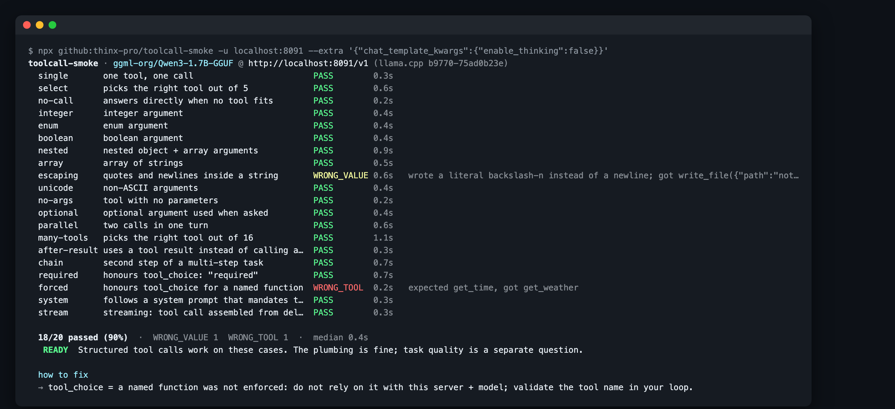
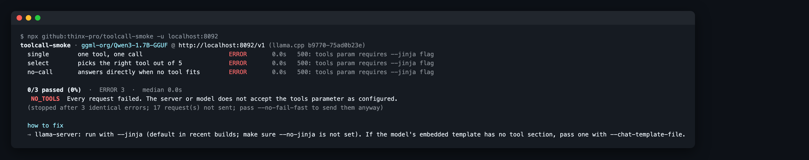

# toolcall-smoke

**Does your local model actually produce structured tool calls through *your* server, or does the call end up as text in `message.content`?** One command, 20 small cases, about 10 seconds on a small model.

   



Works with anything that speaks the OpenAI `chat/completions` API: **Ollama, llama.cpp `llama-server`, LM Studio, vLLM, MLX servers, OpenRouter**, and others.

## Why

A new open-weight model drops, you pull it into Ollama or llama.cpp, point your agent at it, and… the agent just stops. A common reason: the server did not parse the model's tool call. The JSON lands in `message.content`, `tool_calls` is empty, and the agent loop treats it as a final answer. Nothing errors.

This keeps coming up on r/ollama and r/LocalLLaMA ("how do I check that a new model really calls tools?"). Function-calling benchmarks such as BFCL score the **model**. They don't test what is left after **your runtime's chat template and tool-call parser** have handled the output. toolcall-smoke tests that whole path, the one your agent actually depends on.

## Quick start

```bash
# 1. start your server as usual (examples)
ollama serve                                   # → http://localhost:11434/v1
llama-server -hf ggml-org/Qwen3-1.7B-GGUF      # → http://localhost:8080/v1

# 2. run the smoke test
npx github:thinx-pro/toolcall-smoke -u localhost:8080 -m <model>
```

`-m` is optional: by default the first model from `GET /models` is used. A bare `host:port` gets `/v1` appended. The exit code is `1` when the verdict is `LEAKING` or `NO_TOOLS`, so you can use it in CI or in a "new model" script.

## What it checks

| case | what it checks |
|---|---|
| `single` | one tool, one call |
| `select` / `many-tools` | picks the right tool out of 5 / out of 16 |
| `no-call` | answers directly when no tool fits (no spurious calls) |
| `integer` `enum` `boolean` | argument types: `15` not `"15"`, enum values, real booleans |
| `nested` `array` | nested objects and arrays of strings |
| `escaping` | quotes and newlines inside a string argument (catches literal `\n`) |
| `unicode` | non-ASCII arguments survive intact |
| `no-args` | a tool with no parameters (`"{}"`, not `""`) |
| `optional` | optional arguments used when asked |
| `parallel` | two calls in one turn (a single call is reported as `PARTIAL*` and still counts as a pass) |
| `after-result` | uses a tool result to answer instead of calling again |
| `chain` | second step of a multi-step task, after a tool result |
| `required` / `forced` | `tool_choice: "required"` and a named `tool_choice` are honoured |
| `system` | follows a system prompt that mandates tool use |
| `stream` | streaming: the call is reassembled correctly from SSE deltas |

Each response gets one status:

| status | meaning |
|---|---|
| `PASS` | structured `tool_calls` with the right tool and values |
| `LEAK` | the call came back as **text** in `content` (`<tool_call>`, `[TOOL_CALLS]`, bare JSON naming a tool, `name(...)`, …) |
| `BAD_JSON` | `tool_calls` present but `arguments` doesn't parse (including the "arguments repeated in every stream chunk" bug) |
| `BAD_ARGS` | parses, but breaks the schema: wrong type, missing required field, value outside the enum |
| `WRONG_VALUE` | schema-valid but wrong values, or the expected answer is missing |
| `WRONG_TOOL` / `NO_CALL` / `EXTRA_CALL` / `PARTIAL` / `ERROR` | as named |

It also flags things that break real agent loops without failing a case: tool calls with no `id`, `finish_reason` other than `"tool_calls"`, arguments sent as an object instead of a JSON string, double-encoded arguments.

The run ends with a verdict (`READY` / `USABLE` / `UNRELIABLE` / `LEAKING` / `NO_TOOLS`) and **server-specific fix hints**. The server is detected from `/api/version` (Ollama), `/props` (llama.cpp) or `/version` (vLLM). Example: the same model with `llama-server --no-jinja`:



## Real results (so far)

Measured on an M4 Pro Mac mini with llama.cpp b9770 and `ggml-org/Qwen3-1.7B-GGUF` (Q4_K_M), temperature 0:

| config | result | notes |
|---|---|---|
| default (`--jinja`), thinking on, `--max-tokens 2048` | 18/20 | [report](examples/qwen3-1.7b-llamacpp-think.md) |
| thinking off, `--repeat 3` | 54/60 | same 2 cases fail on every run: [report](examples/qwen3-1.7b-llamacpp-nothink.md) |
| `--no-jinja` | 0/3, then stopped | server refuses `tools`: `NO_TOOLS` |

Both failures are useful to know about before you wire up an agent:

- **`forced`**: with a named `tool_choice` (`{"type":"function","function":{"name":"get_time"}}`), this setup still called `get_weather`. Don't count on a named `tool_choice` being enforced here; check the tool name in your loop.
- **`escaping`**: with thinking off, the model wrote a literal backslash-n (the two characters `\` `n`) instead of a newline into `write_file.content`, on all 3 runs. That is the kind of bug that quietly corrupts files an agent writes.

These are results from one small model on one machine, not a leaderboard. Please open an issue with your `--md` report for other model, runtime and quant combinations.

## Options

```
-u, --base-url URL     default $OPENAI_BASE_URL or http://localhost:11434/v1
-m, --model NAME       default: first model from GET /models
-k, --api-key KEY      default $OPENAI_API_KEY (local servers usually need none)
    --only a,b / --skip a,b
    --repeat N         run each case N times (sampling noise, flaky parsers)
    --temperature T    default 0
    --max-tokens N     default 1024 (raise it for reasoning models)
    --extra JSON       merged into every request, e.g. '{"chat_template_kwargs":{"enable_thinking":false}}'
    --timeout S        per request, default 120
    --fail-under PCT   exit 1 below this pass rate
    --json / --md FILE / --raw / --list / --no-fail-fast
```

## How it works

- One plain `POST /chat/completions` per case, sent one at a time, with `tools`, an optional `tool_choice`, and `stream` for the streaming case. No SDK and no dependencies: Node's built-in `fetch`.
- Streaming responses are reassembled the way an agent loop has to do it: `content` is concatenated, and `tool_calls[i].function.arguments` is concatenated by `index`.
- Arguments are checked against each tool's JSON Schema (a small subset validator: `type`, `required`, `enum`, `properties`, `items`), then against a value check for that case.
- Leak detection strips `<think>…</think>` first, so a model *reasoning about* a tool isn't counted as a leak.
- If the first 3 requests fail with the same server error, the run stops instead of sending 17 more requests that would fail the same way.

## Limitations and roadmap

- Tested live only against **llama.cpp**. The Ollama, LM Studio and vLLM paths (leak shapes, fix hints, server detection) are covered by unit tests with mocked responses, not live runs. Reports from those servers are very welcome.
- 20 cases test plumbing, not intelligence. A `READY` model can still be bad at your task.
- Leak detection is pattern-based and may miss exotic formats. Use `--json --raw` to see the raw output.
- Planned: Anthropic `/v1/messages` mode, a few multi-turn agent-loop cases (5+ steps), a public results table built from submitted `--md` reports, and a `--compare` mode to diff two server configs.

## Development

```bash
npm test        # 24 tests, uses a built-in mock server; no model needed
```

## License

MIT

---

### 中文简介

**toolcall-smoke**：一条命令检查本地模型在你的推理服务（Ollama / llama.cpp / LM Studio / vLLM 等 OpenAI 兼容接口）下，是否真的返回结构化的 `tool_calls`，而不是把工具调用当成文本塞进 `message.content`（后一种情况会让 Agent 循环静默结束）。20 个小用例覆盖参数类型、嵌套、转义、多工具选择、并行调用、`tool_choice`、流式拼装等；每次运行给出判定结论，并针对不同服务端给出修复建议。零依赖，Node 18+：`npx github:thinx-pro/toolcall-smoke -u localhost:8080`。实测数据目前只有 llama.cpp + Qwen3-1.7B，欢迎提交其他组合的报告。
